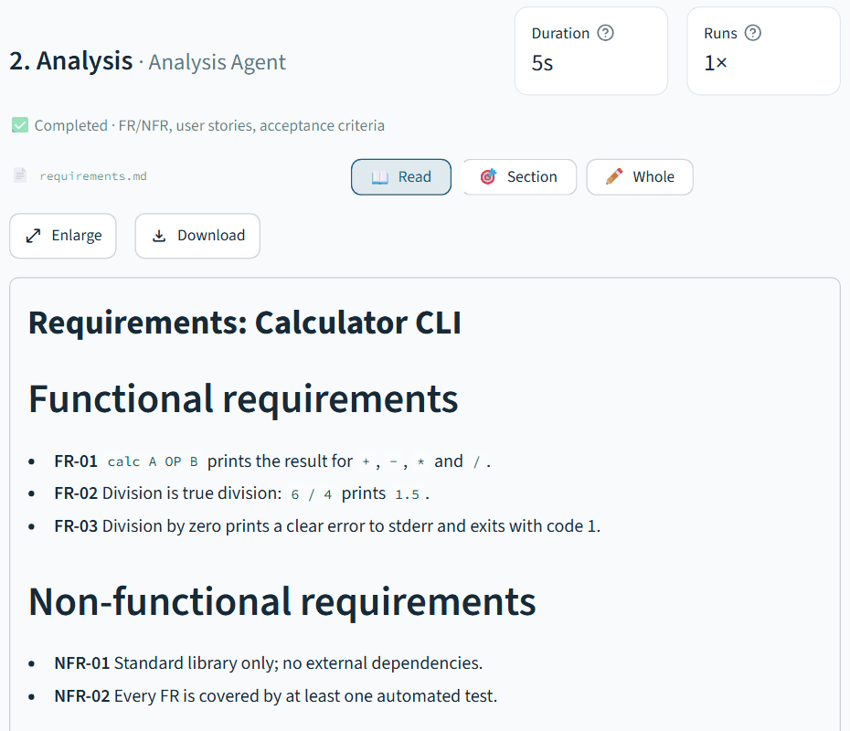
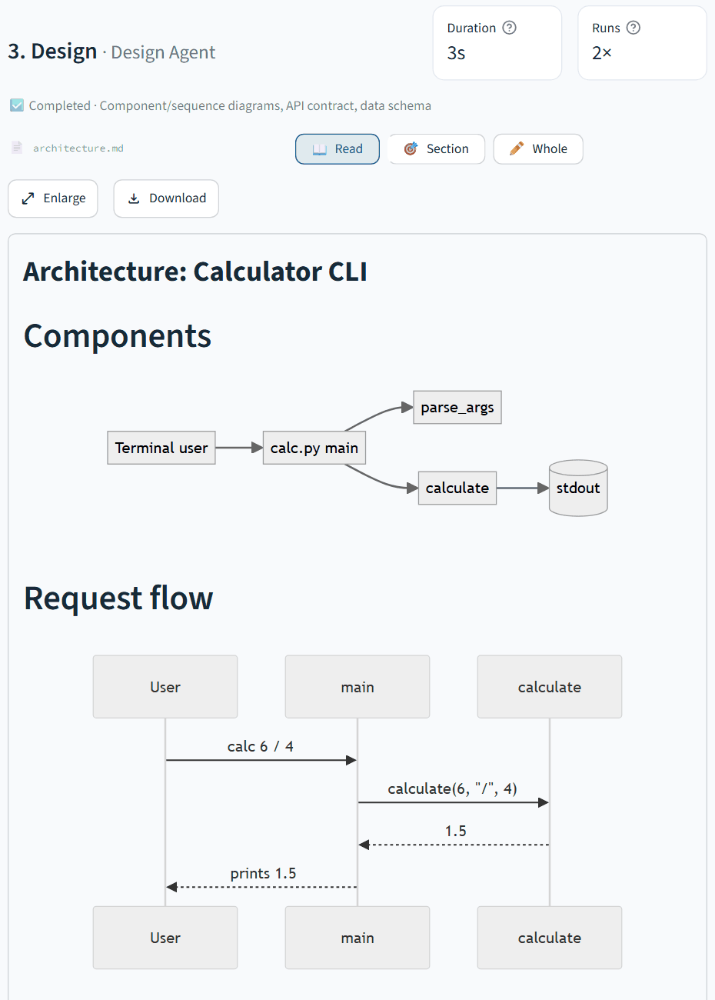
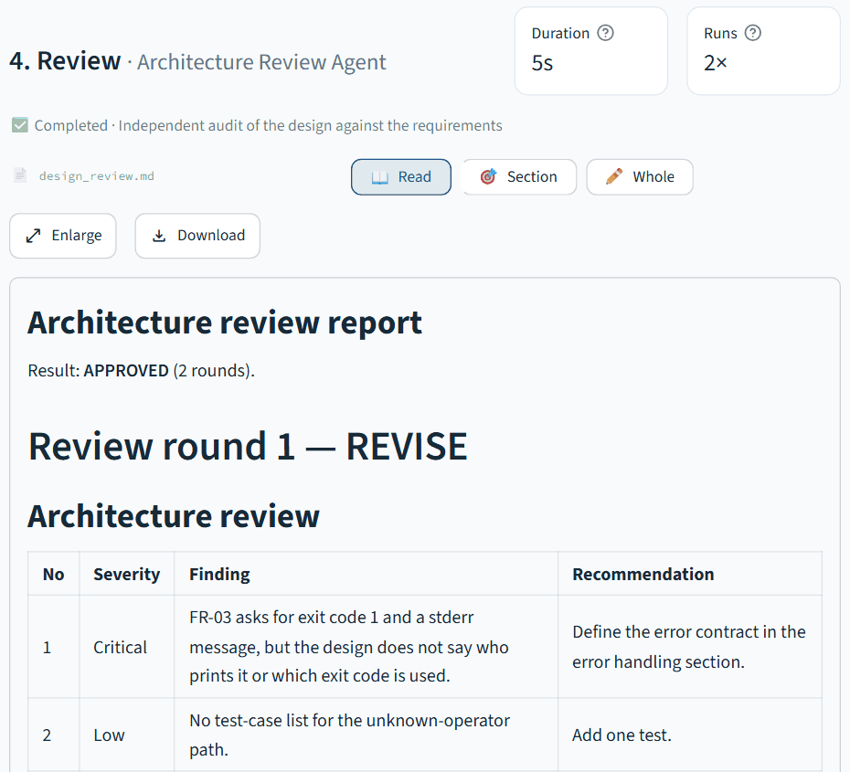
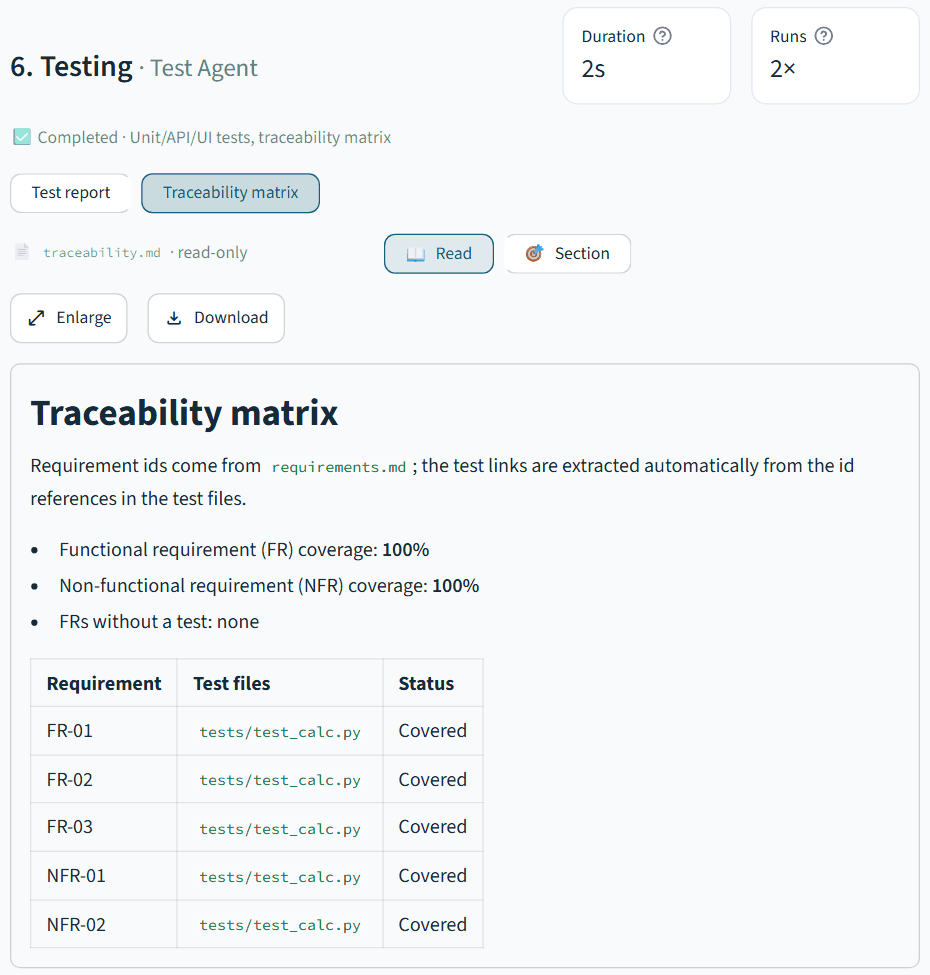
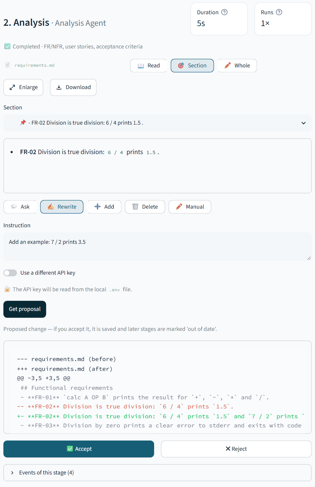

# AutoSDLC

[English](README.md) · [Türkçe](README.tr.md)

**Bir yazılım fikrini yapay zekâ ajanlarıyla testleri ve belgeleri olan bir projeye dönüştürün.** AutoSDLC, CrewAI Flows ile sekiz ajanı yazılım geliştirme yaşam döngüsünde koordine eder ve çalışmayı canlı olarak gösterir. Her proje için teknoloji yığınını siz seçersiniz: üretici Python ile yazılmıştır, oluşturduğu uygulamalar başka dilleri ve framework'leri kullanabilir.


*Baştan sona bir çalışma: şablon seç, ajanların canlı çalışmasını izle, bir ajanın sorusunu yanıtla, incelemenin tasarımı geri gönderdiğini ve testlerin onarımı tetiklediğini gör, ardından API kesintisinden sonra Retry yap. Kayıt, senaryolu bir demo motoruyla sürülen gerçek arayüzdür; buradaki proje verileri ve konuşmalar kurgusaldır, model çağrısı yapılmamıştır.*


### SDLC sonuçları

| Başarılı çalışma | Test hatası |
| --- | --- |
|  |  |

**Yeniden deneme:** önceki aşamalar korunarak başarısız API testi Test aşamasından tekrar çalıştırılıyor.


Bu durum örnekleri aynı kurgusal proje verisini kullanır. Retry durumu simülasyondur; görseller gerçek bir model çalıştırmasını göstermez.

### Üretilen belgeler

Her aşama okuyabileceğiniz, düzenleyebileceğiniz ve indirebileceğiniz bir Markdown belgesi yazar. Aşağıdakiler örnek projeden kırpılmış görünümlerdir (İngilizce arayüz, kurgusal veri):

| Gereksinimler (Analiz Ajanı) | Mermaid diyagramlı mimari (Tasarım Ajanı) |
| --- | --- |
|  |  |
| **Mimari inceleme (İnceleme Ajanı)** | **İzlenebilirlik matrisi (Test Ajanı)** |
|  |  |

**Yalnızca tüm dosyayı değil, herhangi bir bölümü düzenleyin.** Bir başlık ya da tek bir gereksinim seçin; ardından soru sorun, yeniden yazdırın, ekleyin, silin veya elle düzenleyin. Ajanın önerisi kabul ya da reddedeceğiniz bir diff olarak görünür; kabul ederseniz sonraki aşamalar güncel değil olarak işaretlenir.



## Neler yapar?

- Planlama, gereksinim analizi, mimari tasarım ve inceleme, kodlama, test, dağıtım ve bakım belgelerini üretir.
- Aşamaların durumunu, ajan çıktısını, revizyon ve onarım döngülerini, kullanıcı sorularını canlı gösterir.
- Ajan sorularını yanıtlamanıza, belge değişikliklerini incelemenize ve kararlarınızla akışı sürdürmenize olanak verir.
- Projeyi, kaynak kodu veya SDLC belgelerini ZIP olarak indirir.
- İhtiyaca göre API ve browser testleri oluşturur; database, cache ve observability servisleri için Docker Compose hazırlayabilir.
- Her projeyi seçtiğiniz şekilde teslim eder: Docker imajı, hazır çalıştırılabilir dosyalar (Go için Windows `.exe`, Linux ve macOS; Rust için Windows ve Linux), `run.sh`/`run.bat` başlatıcıları ya da yalnızca kaynak kod. CLI'lar varsayılan olarak çalıştırılabilir dosya, library'ler yalnızca kaynak kod olarak gelir.

## Başlarken

Gereksinimler: Python 3.11–3.13, [OpenCode Go](https://opencode.ai/go) erişimi ve `make`. Docker yalnızca oluşturulan projeleri container içinde çalıştırmak için gereklidir.

```bash
git clone https://github.com/<owner>/autosdlc.git
cd autosdlc
```

OpenCode Go anahtarınızı `.env` dosyasına ekleyin (dosya Git tarafından yok sayılır):

```dotenv
OPENCODE_API_KEY=your_key_here
```

Uygulamayı başlatın. İlk çalıştırma virtual environment oluşturur, bağımlılıkları kurar ve browser arayüzünü açar:

```bash
make run
```

Proje fikrini yazıp language, stack ve infrastructure seçimlerini yapın, ardından **Projeyi oluştur** düğmesine basın. Özel bir path belirtmezseniz proje `projects/` içine kaydedilir. Formdan **Belge dili** seçilebilir; arayüz dili ayrıca değiştirilebilir.

## Tasarım sırasında bir karar

Net olmayan bir mimari kararda ajan projeyi durdurup çalışma alanında size soru yöneltebilir:

> Stok değişiklikleri audit history olarak mı kaydedilsin, yoksa mevcut miktarı tutmak yeterli mi?

Ajan chat'inde yanıt verebilirsiniz. Yanıtınız run ile saklanır ve sonraki aşamalara aktarılır. Yukarıdaki soru temsili bir örnektir; gerçek sorular projenize göre belirlenir.

## Geliştirme

```bash
make setup  # uygulama ve Playwright Chromium kurulumu
make test   # testleri çalıştır
```

Oluşturulan projenin araçları ve servisleri projeye göre seçilir. AI tarafından üretilen kodu çalıştırmadan veya dağıtmadan önce inceleyin; üretilen komutlar yerel subprocess olarak çalışır.

## Docker ile yayınlama (Dokploy / herhangi bir VPS)

Depoda bir `Dockerfile` ve bir `docker-compose.yml` vardır. İmajda uygulama, Playwright Chromium ve üretilen projelerin ihtiyaç duyduğu araçlar bulunur (Python 3.12, npm ve pnpm ile Node.js 22, Go 1.24, Windows hedefiyle Rust, mingw-w64, git ve C derleyicisi); imaj büyüktür (diskte yaklaşık 7–8 GB). Diğer stack'ler (Java vb.) kurulu değildir. Projeler ve çalıştırma geçmişi `/data` volume'unda tutulur.

| Değişken | Amaç |
|----------|------|
| `OPENCODE_API_KEY` | Örneği kullanan herkesin paylaştığı OpenCode Go anahtarı |
| `AUTOSDLC_MODEL` | Varsayılan model (isteğe bağlı) |
| `AUTOSDLC_TIMEZONE` | Arayüz ve raporlardaki saatlerin saat dilimi, IANA adıyla (varsayılan `Europe/Istanbul`; ör. `UTC`, `Europe/Berlin`) |
| `APP_PASSWORD` | Web arayüzü için ortak parola. Boş bırakılırsa arayüze erişebilen herkes kullanır (logda uyarı yazılır) |

```bash
docker compose up -d --build   # 8501 portunda yayın yapar
```

Dokploy'da bu depodan bir **Compose** (veya Dockerfile ile **Application**) servisi oluşturun, yukarıdaki değişkenleri ortamına girin, alan adınızı `8501` portuna yönlendirip HTTPS'i açın; TLS'i Dokploy'un Traefik'i sonlandırır ve Streamlit'in ihtiyaç duyduğu WebSocket'leri iletir. Tek bir ortak parola vardır, kullanıcı ayrımı yoktur: giriş yapan herkes tüm projeleri görür ve aynı API anahtarını harcar. Üretilen kod (testler, sunucular, Chromium) konteynerin içinde çalışır; parolayı bu konteynere erişim olarak düşünün.

## Proje referansları

[CrewAI Flows](https://docs.crewai.com/concepts/flows) · [OpenCode Go](https://opencode.ai/go) · [Streamlit](https://streamlit.io/) · [FastAPI](https://fastapi.tiangolo.com/) · [Pytest](https://docs.pytest.org/) · [Playwright](https://playwright.dev/python/)

Workflow task'ları ve ajan rolleri [`tasks.yaml`](src/autosdlc/config/tasks.yaml) içinde; başlangıç proje fikirleri [`templates.yaml`](src/autosdlc/config/templates.yaml) dosyasındadır.
