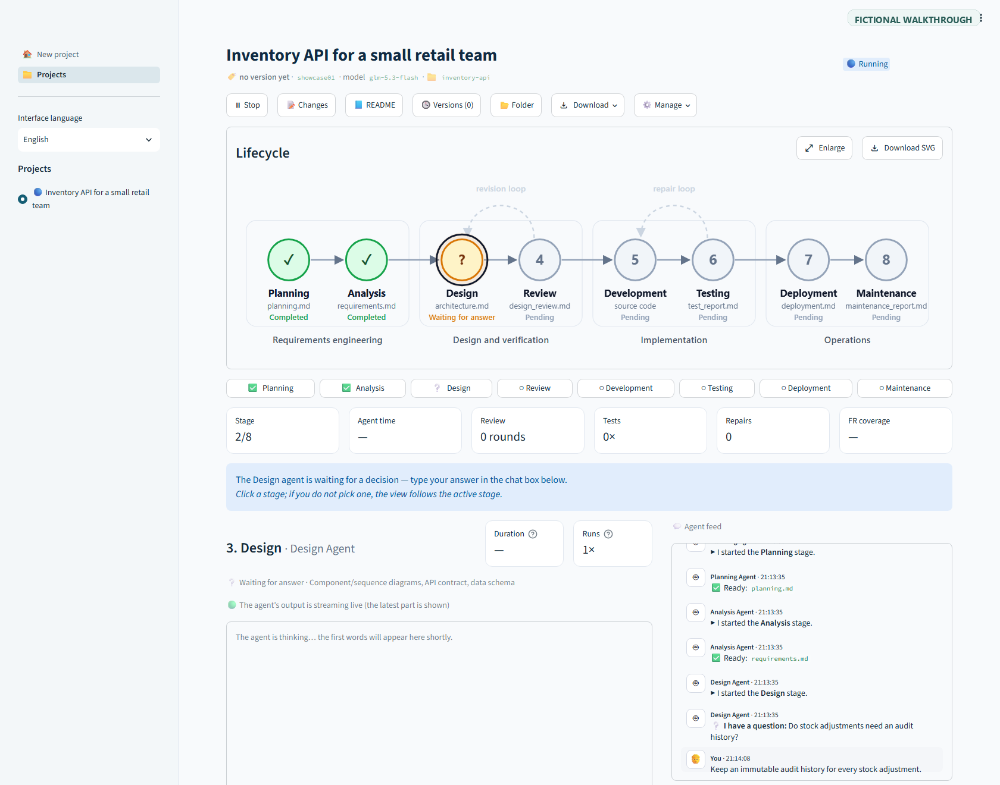
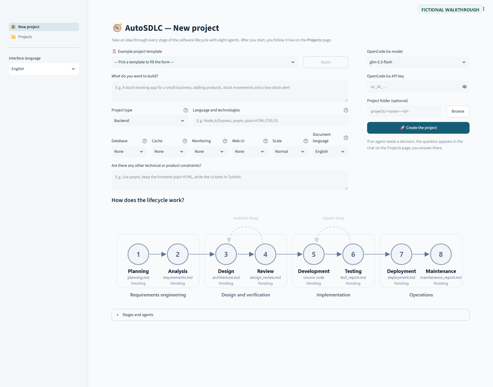
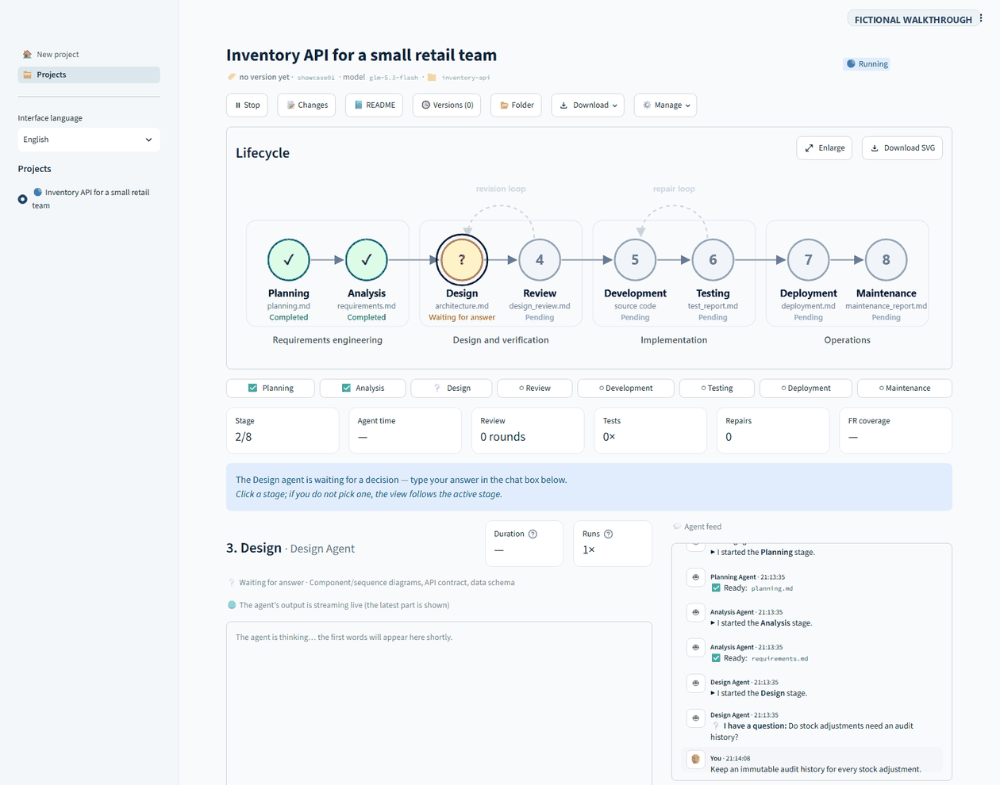
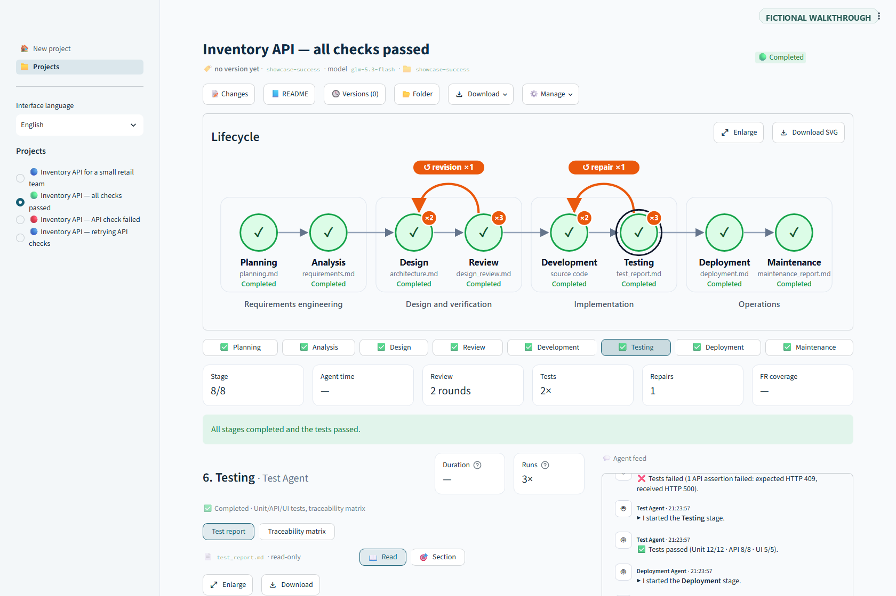
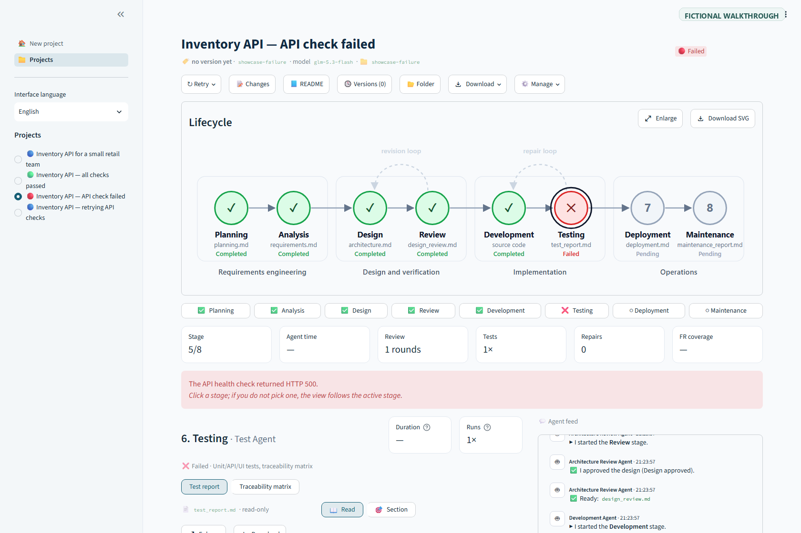
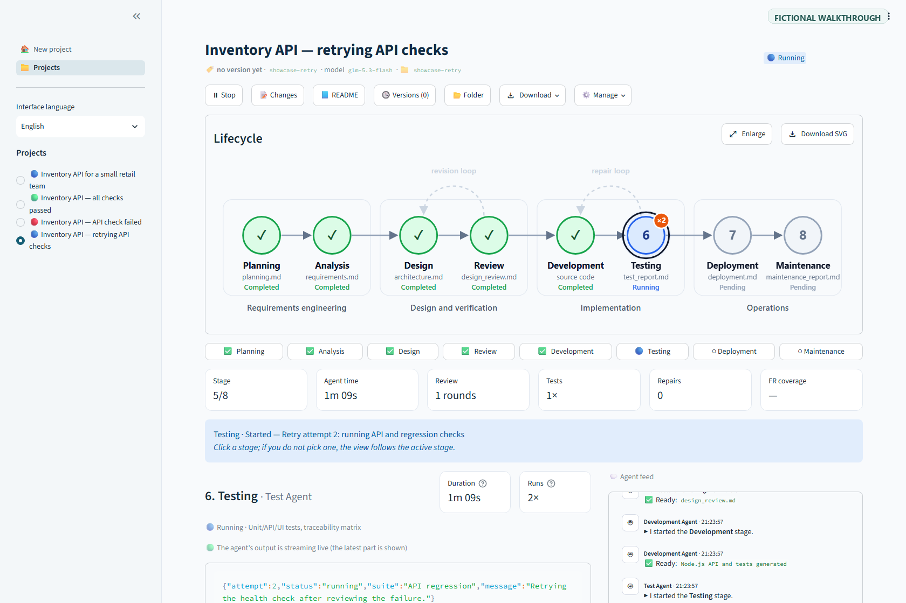

# AutoSDLC

[English](README.md) · [Türkçe](README.tr.md)

**Bir yazılım fikrini yapay zekâ ajanlarıyla testleri ve belgeleri olan bir projeye dönüştürün.** AutoSDLC, CrewAI Flows ile sekiz ajanı yazılım geliştirme yaşam döngüsünde koordine eder ve çalışmayı canlı olarak gösterir. Her proje için teknoloji yığınını siz seçersiniz: üretici Python ile yazılmıştır, oluşturduğu uygulamalar başka dilleri ve framework'leri kullanabilir.



*Örnek proje ve ajan sorusu. Görsellerdeki proje verileri ve konuşma kurgusaldır; bunları hazırlarken model çağrısı yapılmamıştır.*





### SDLC sonuçları

| Başarılı çalışma | Test hatası |
| --- | --- |
|  |  |

**Yeniden deneme:** önceki aşamalar korunarak başarısız API testi Test aşamasından tekrar çalıştırılıyor.



Bu durum örnekleri aynı kurgusal proje verisini kullanır. Retry durumu simülasyondur; görseller gerçek bir model çalıştırmasını göstermez.

## Neler yapar?

- Planlama, gereksinim analizi, mimari tasarım ve inceleme, kodlama, test, dağıtım ve bakım belgelerini üretir.
- Aşamaların durumunu, ajan çıktısını, revizyon ve onarım döngülerini, kullanıcı sorularını canlı gösterir.
- Ajan sorularını yanıtlamanıza, belge değişikliklerini incelemenize ve kararlarınızla akışı sürdürmenize olanak verir.
- Projeyi, kaynak kodu veya SDLC belgelerini ZIP olarak indirir.
- İhtiyaca göre API ve browser testleri oluşturur; database, cache ve observability servisleri için Docker Compose hazırlayabilir.

## Başlarken

Gereksinimler: Python 3.11–3.13, [OpenCode Go](https://opencode.ai/go) erişimi ve `make`. Docker yalnızca oluşturulan projeleri container içinde çalıştırmak için gereklidir.

```bash
git clone https://github.com/<owner>/autosdlc.git
cd autosdlc
```

OpenCode Go anahtarınızı `.env` dosyasına ekleyin (dosya Git tarafından yok sayılır):

```dotenv
OPENCODE_API_KEY=your_key_here
```

Uygulamayı başlatın. İlk çalıştırma virtual environment oluşturur, bağımlılıkları kurar ve browser arayüzünü açar:

```bash
make run
```

Proje fikrini yazıp language, stack ve infrastructure seçimlerini yapın, ardından **Projeyi oluştur** düğmesine basın. Özel bir path belirtmezseniz proje `projects/` içine kaydedilir. Formdan **Belge dili** seçilebilir; arayüz dili ayrıca değiştirilebilir.

## Tasarım sırasında bir karar

Net olmayan bir mimari kararda ajan projeyi durdurup çalışma alanında size soru yöneltebilir:

> Stok değişiklikleri audit history olarak mı kaydedilsin, yoksa mevcut miktarı tutmak yeterli mi?

Ajan chat'inde yanıt verebilirsiniz. Yanıtınız run ile saklanır ve sonraki aşamalara aktarılır. Yukarıdaki soru temsili bir örnektir; gerçek sorular projenize göre belirlenir.

## Geliştirme

```bash
make setup  # uygulama ve Playwright Chromium kurulumu
make test   # testleri çalıştır
```

Oluşturulan projenin araçları ve servisleri projeye göre seçilir. AI tarafından üretilen kodu çalıştırmadan veya dağıtmadan önce inceleyin; üretilen komutlar yerel subprocess olarak çalışır.

## Proje referansları

[CrewAI Flows](https://docs.crewai.com/concepts/flows) · [OpenCode Go](https://opencode.ai/go) · [Streamlit](https://streamlit.io/) · [FastAPI](https://fastapi.tiangolo.com/) · [Pytest](https://docs.pytest.org/) · [Playwright](https://playwright.dev/python/)

Workflow task'ları ve ajan rolleri [`tasks.yaml`](src/autosdlc/config/tasks.yaml) içinde; başlangıç proje fikirleri [`templates.yaml`](src/autosdlc/config/templates.yaml) dosyasındadır.
